# ObjectARX 多年份向导（经典向导版）· 使用指南

**适用安装包：`ObjectARXMultiVersionWizards-classic.exe`（单文件安装包）**

> 另两份分发线指南：[main 版（MSI + Burn 安装包）](ObjectARX多年份向导使用指南-main.md) · [dev 版（Inno 单文件安装包）](ObjectARX多年份向导使用指南-dev.md)。

本指南面向拿到安装包的最终用户。读完本文，您可以独立完成：安装 → 新建 ObjectARX 工程 → 添加类 → 编译与在 AutoCAD 中加载调试 → 日后修改年份/重装/卸载。

> 本安装包提供的是 **经典多页式 ObjectARX 向导**（HTML 向导界面，英文），项目向导与类向导都集成在 Visual Studio 自身的向导体系中，操作方式与 Autodesk 历年发布的 ObjectARX Wizard 一致。

> 📷 **插图约定**：截图按分发线存放在 `docs\images\` 下的子文件夹（`classic\` / `main\` / `dev\`），文件名一律用英文短横线命名（如 `classic-01-install-dir.png`）。已就位的截图直接以图片嵌入正文；仍以 📷 引用块标注的是待补截图，块内写明了应截取的画面与目标文件名。

---

## 目录

1. [这套向导是什么](#1-这套向导是什么)
2. [安装前的准备](#2-安装前的准备)
3. [图形化安装（逐页说明）](#3-图形化安装逐页说明)
4. [静默安装（企业/批量部署）](#4-静默安装企业批量部署)
5. [安装后检查](#5-安装后检查)
6. [新建第一个 ObjectARX 工程](#6-新建第一个-objectarx-工程)
7. [向工程中添加 ObjectARX 类](#7-向工程中添加-objectarx-类)
8. [编译、加载与调试](#8-编译加载与调试)
9. [年份 / 工具集 / 平台速查表](#9-年份--工具集--平台速查表)
10. [增减目标年份、重装与卸载](#10-增减目标年份重装与卸载)
11. [常见问题](#11-常见问题)

---

## 1. 这套向导是什么

安装后，Visual Studio 中会多出两类向导，用于 AutoCAD ObjectARX 二次开发：

**2 个项目向导（文件 → 新建 → 项目）**

| 向导名称 | 用途 |
|---|---|
| ObjectARX/DBX/CRX Application (Multi-Version) | 创建 ObjectARX（`.arx`）、ObjectDBX（`.dbx`）或 AutoCAD 控制台（`.crx`）应用 |
| ObjectARX/DBX Application with OMF Support (Multi-Version) | 同上，并支持 OMF / MAP 垂直 SDK（面向 AutoCAD Architecture 等建筑类产品），会额外生成一个 Enu 资源 DLL 子项目 |

**7 个类向导（向已有工程添加文件）**

自定义实体、反应器、Jig、MFC 界面类、.NET 包装、ATL COM 包装、动态特性（详见[第 7 节](#7-向工程中添加-objectarx-类)）。

如果本机同时安装了 Visual Studio 2022 和 2026，安装器会把这套向导读入**两个版本**的 Visual Studio。

**“多年份单工程”是什么意思？**

一个生成的工程同时包含 AutoCAD 2010–2027 各年份的编译配置：每个年份两套配置，例如 `2024|x64`（Release）和 `2024d|x64`（Debug）。在配置工具栏切换即可为不同版本的 AutoCAD 编译，无需维护多个工程；输出文件名自动带年份后缀，例如 `MyApp2024.arx`、`MyApp2024d.arx`。

---

## 2. 安装前的准备

| 项目 | 要求 |
|---|---|
| 操作系统 | 64 位 Windows |
| Visual Studio | **Visual Studio 2022（17.x）或 Visual Studio 2026（18.x）**，Community / Professional / Enterprise 均可；需在 Visual Studio Installer 中勾选“使用 C++ 的桌面开发”工作负荷。安装程序启动时会检测 VS，检测不到将直接退出 |
| ObjectARX SDK | 从 Autodesk Developer Network 下载您要支持的各年份 ObjectARX SDK（编译时需要，安装向导本身不强制） |
| AutoCAD | 用于加载、调试生成的 `.arx/.dbx/.crx` |
| 旧年份工具集（按需） | 编译 2010–2019 的配置时，还需在 VS Installer 中加装对应旧版生成工具（如 **MSVC v140、v120/v110/v100、v90 生成工具**）与旧版 Windows SDK；只做 2020 以后版本可忽略 |
| .NET（按需） | 勾选“.NET mixed managed code”时：2025 及以后配置需要 .NET 8（2027 需要 .NET 10）托管工具链；更早年份需要对应 .NET Framework 开发包（3.5 / 4.x） |
| 权限 | 需要管理员权限，启动时会弹出 UAC，请点击“是” |

**安装前请关闭所有 Visual Studio 窗口**（以及 Visual Studio Installer）。安装程序检测到 VS 正在运行会拒绝继续，这是为了避免向导读写到一半失败——此时尚未写入任何内容，关闭 VS 后重新运行即可。

---

## 3. 图形化安装（逐页说明）

双击 `ObjectARXMultiVersionWizards-classic.exe`，在 UAC 提示中点击“是”。安装包为简体中文界面（非中文系统自动显示英文），首次安装依次出现以下页面（重新安装会跳过“选择安装位置”页）：

### 第 1 页：欢迎

直接点击“下一步”。

### 第 2 页：选择安装位置（仅首次安装）

- 向导文件的安装目录，默认 `C:\Program Files\Autodesk\ObjectARX Multi-Version Wizards\`，可点击“浏览…”自行选择；
- **属性表目录默认自动跟随安装目录**；
- **重新安装（覆盖安装）时本页不会出现**：安装器直接沿用上次的安装目录，其余步骤与首次安装完全一致。要更换目录请先卸载再装，或用静默参数 `/DIR=` 指定。


### 第 3 页：注册开发者符号（RDS）

- 新建工程时使用的默认开发者前缀（最长 4 个字符），生成代码和输出文件名都会用到它；
- **可以留空**，留空则使用内置的 `ADSK`；
- RDS 的官方含义见 ObjectARX 文档的 *Symbols Registration*，不确定就直接点“下一步”。

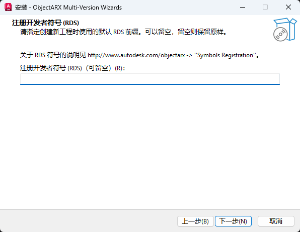

### 第 4 页：ObjectARX SDK 与目标位置

两个目录，**AutoCAD 和 SDK 装在默认位置时整页都不用改**。本版安装器**不会向 SDK 安装目录写入或修改任何文件**：

| 字段 | 含义 | 默认值 |
|---|---|---|
| Autodesk CAD 目录 | AutoCAD 所在的根目录，年份由属性表自动拼接（`$(AcadRoot)AutoCAD <年份>\`） | `C:\Program Files\Autodesk\` |
| ObjectARX SDK 目录 | ObjectARX SDK 所在的根目录，年份由属性表自动拼接（`$(ArxSdkRoot)ObjectARX <年份>\`） | `C:\Program Files\Autodesk\` |

> 属性表目录不在这里选：它恒等于安装目录。

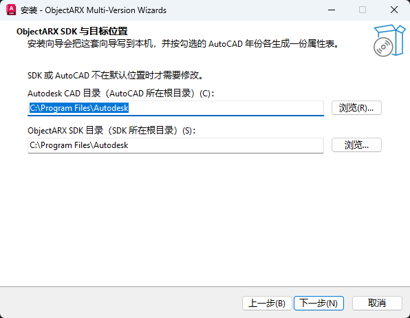

### 第 5 页：目标 AutoCAD 版本

- 年份分两列显示，勾选您需要支持的 AutoCAD 年份。**每勾选一个年份，就生成一份对应的属性表**；未勾选的不生成；
- 勾选了本机暂时没装 SDK 的年份也没有任何副作用，以后装好 SDK 直接就能编译；
- 首次安装默认勾选 **2020、2024、2026、2027**；如果是覆盖安装，会自动回显上次已生成属性表的年份；
- 四个快捷按钮：**全部**（勾上 16 个年份）、**全不选**、**反选**、**兼容**（只勾各二进制兼容代系的代表年份：2014、2016、2018、2020、2024、2026、2027，同代系共用一套属性表）。

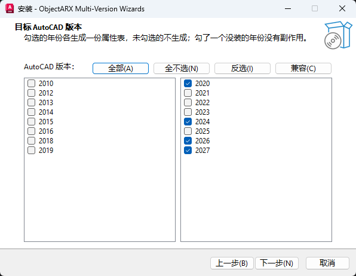

### 第 6 页：准备安装

本页以清单形式汇总前面的全部选择（安装目录、RDS、Autodesk CAD 目录、ObjectARX SDK 目录、目标年份），确认无误后点击“安装”。

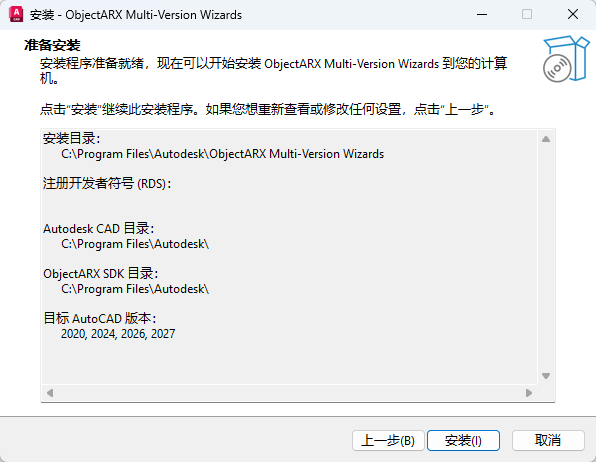

### 安装过程中

1. 复制向导文件、生成勾选年份的属性表；
2. 把项目向导和类向导读入 Visual Studio（2022、2026 都会处理），并请求 VS 刷新向导列表；
3. 自动安装 Visual Studio 扩展组件（它负责让 VS 重新生成向导读取列表，本身不提供额外模板入口）。此步骤可能弹出 Visual Studio 自带的扩展安装窗口并持续 1–2 分钟，属正常现象，**请勿手动关闭它**。

看到“安装完成”后，**重新启动 Visual Studio**。

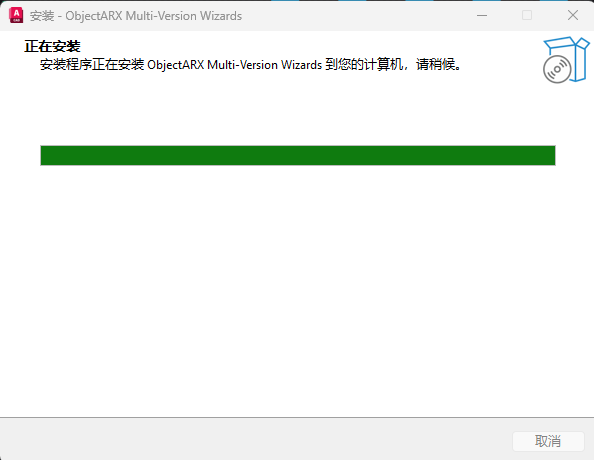

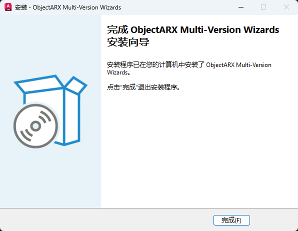

---

## 4. 静默安装（企业/批量部署）

以管理员身份运行，例如：

```bat
ObjectARXMultiVersionWizards-classic.exe /VERYSILENT /SUPPRESSMSGBOXES /YEARS=2020,2024,2026,2027 /RDS=ACME
```

| 参数 | 作用 |
|---|---|
| `/VERYSILENT` | 完全静默，不显示向导界面与进度框 |
| `/SUPPRESSMSGBOXES` | 抑制提示框（建议与 `/VERYSILENT` 一起用） |
| `/YEARS=2020,2024` | 预设勾选的年份（逗号分隔，不要加空格） |
| `/RDS=符号` | RDS 前缀；省略则使用 ADSK |
| `/DIR=路径` | 安装目录 |
| `/PROPSDIR=路径` | 属性表目录；省略则跟随安装目录 |
| `/ACADROOT=路径` | Autodesk CAD 根目录（AutoCAD 所在根目录） |
| `/ARXROOT=路径` | ObjectARX SDK 根目录（SDK 所在根目录） |
| `/VSROOT=路径` | 手工指定 Visual Studio 安装根目录（自动检测不到时使用） |
| `/SKIPVSIX=1` | 只装文件和属性表，跳过扩展组件（此时需自行让 VS 刷新向导列表） |
| `/SKIPVSCHECK=1` | Visual Studio 正在运行也继续安装（不推荐） |

---

## 5. 安装后检查

打开 Visual Studio 2022 或 2026：

1. **文件 → 新建 → 项目**（或按 `Ctrl+Shift+N`）；
2. 搜索框输入 **ObjectARX**（或在语言中选 C++）；
3. 应看到两个向导：**ObjectARX/DBX/CRX Application (Multi-Version)** 与 **ObjectARX/DBX Application with OMF Support (Multi-Version)**。

能看到即表示安装成功。若看不到，见[第 11 节](#11-常见问题)。

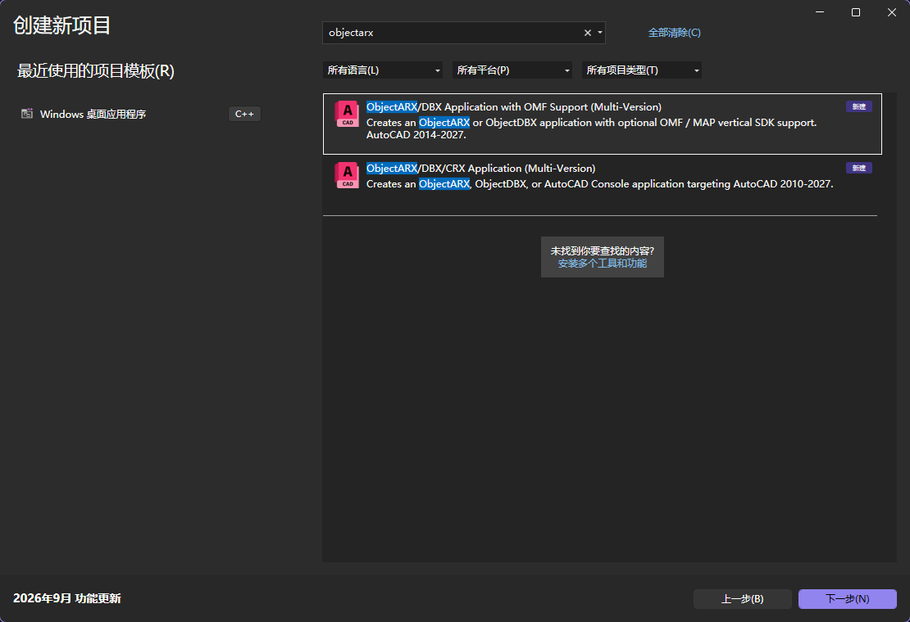

---

## 6. 新建第一个 ObjectARX 工程

### 6.1 操作步骤

1. **文件 → 新建 → 项目**，搜索 ObjectARX，选择 **ObjectARX/DBX/CRX Application (Multi-Version)**，点击“下一步/确定”；
2. 输入工程名（例如 `MyArxApp`）和保存位置，确认后弹出经典的 **ObjectARX/DBX Application Wizard** 多页向导（英文界面，左侧为步骤导航栏）。

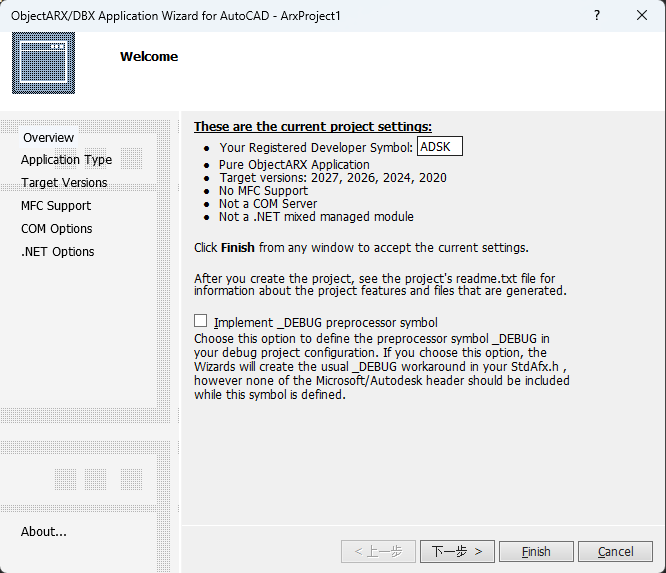

### 6.2 向导各页说明

向导通过左侧导航在各步骤间切换，按“Next >”逐页前进：

**① 概览页（Overview）**

- **Your Registered Developer Symbol**：开发者前缀，最长 4 个字符，默认 `ADSK`，输出文件与样板代码都会使用它；
- **Implement _DEBUG**：勾选后在工程中预置 `_DEBUG` 宏，一般不勾。

**② Application Type（应用程序类型）**

| 单选项 | 含义 |
|---|---|
| ObjectARX | 标准 AutoCAD 扩展，输出 `.arx`（最常用） |
| ObjectDBX (Custom DBX application) | 宿主无关的数据库应用，输出 `.dbx`（可被 RealDWG/DBX 宿主加载） |
| Console | AutoCAD 控制台程序，输出 `.crx` |

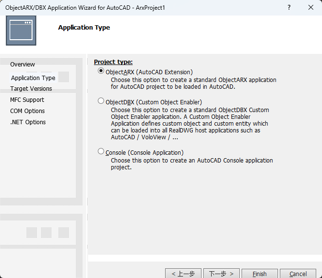

**③ Version（目标版本）**

- 两列复选框列出 2010–2027 全部年份，勾选要纳入工程的年份；
- **本机未安装属性表的年份会显示为灰色锁定状态**（无法勾选）——需要时重新运行安装包补勾该年份（见[第 10 节](#10-增减目标年份重装与卸载)）；
- 页面提示：每勾选一个年份，工程中就增加一对配置（例如 `2026` 和 `2026d`），并把年份追加到输出模块名（例如 `MyApp2026.arx`）。

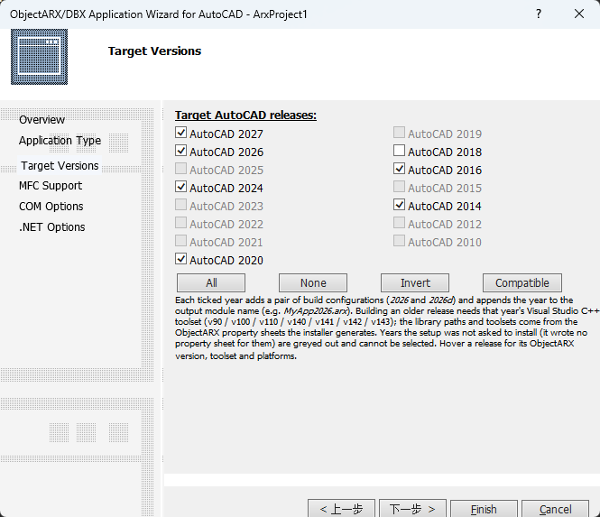

**④ MFC（MFC 支持）**

| 单选项 | 含义 |
|---|---|
| No MFC | 不使用 MFC（纯命令/实体开发通常选这个） |
| Regular DLL with MFC Statically | 静态链接 MFC 的规则 DLL |
| Regular DLL using MFC Shared | 动态 MFC 规则 DLL |
| Extension DLL using MFC Shared | MFC 扩展 DLL；要使用 AutoCAD AdUi/AcUi 界面类时选它 |
| AutoCAD MFC Extension（勾选项） | 同时链接 AutoCAD MFC 扩展 |

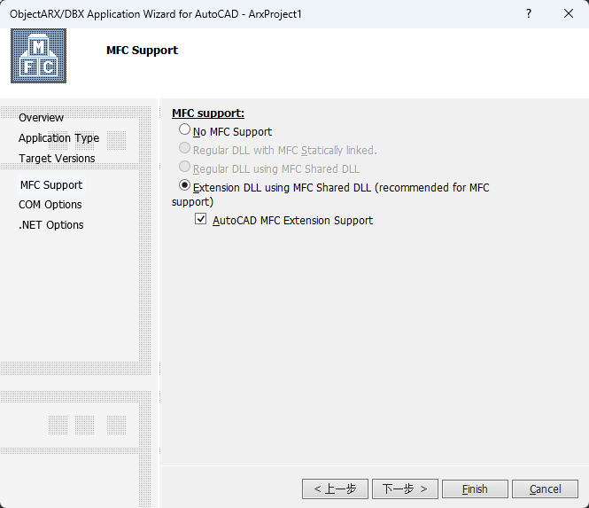

**⑤ COM（COM 选项）**

- Not a COM server：不做 COM（多数人选这个）；
- Implement a COM server / using ATL：向 VBA、.NET 等 COM 客户端暴露对象；
- 下方还可选择是否 `#import` ObjectDBX 或 AutoCAD 类型库。

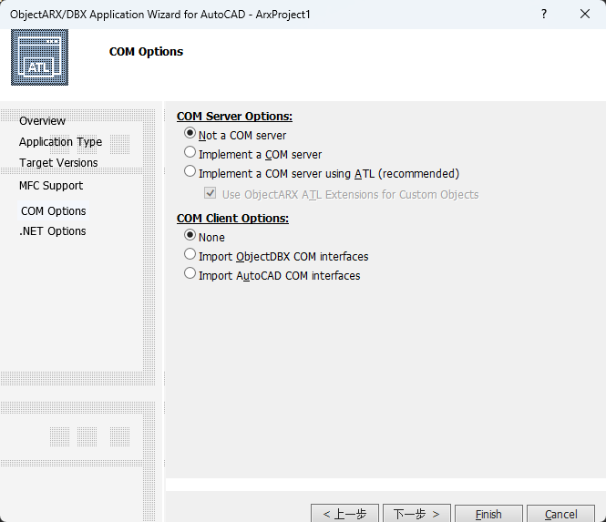

**⑥ .NET（托管选项）**

- **.NET mixed managed code**：生成 C++/CLI 混合模块（2025 起为 .NET 8/10，更早年份为 .NET Framework）；
- 下面两项为 AutoCAD Architecture (ACA) / AutoCAD MEP 垂直产品的 .NET 支持，按需勾选。

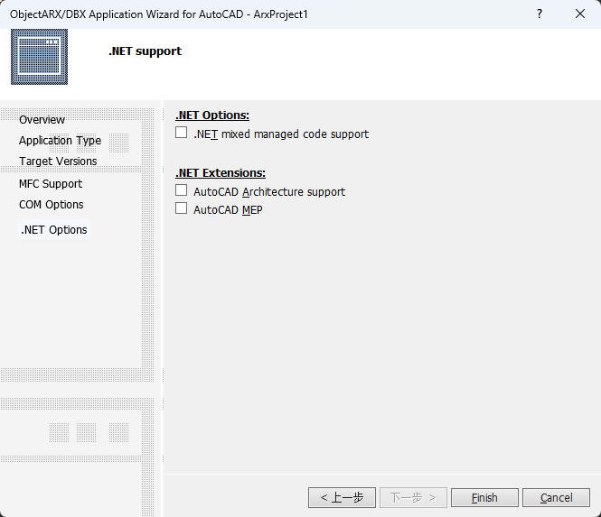

**OMF 模板额外的一步：Verticals（仅第二个项目向导有）**

- **OMF application support**：生成 OMF 垂直应用，会强制采用 MFC Extension DLL；
- **MAP API support**：加入 MAP API 支持，会强制 ObjectARX 应用类型；
- OMF 工程创建后，解决方案中会多一个 **Enu 资源 DLL 子项目**，主项目自动依赖它。

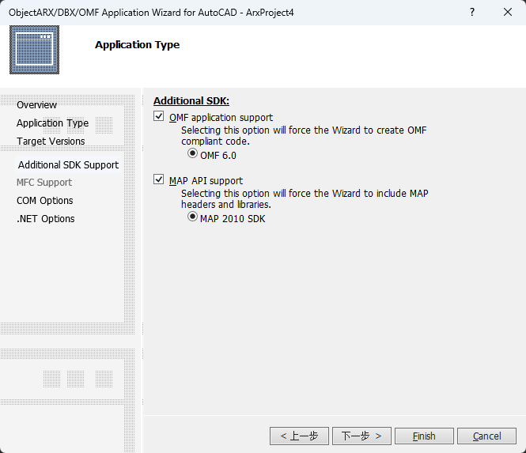

### 6.3 完成创建

各页选择完毕后，在任意一页点击 **Finish**（概览页）生成工程。生成内容包括：

- `acrxEntryPoint.cpp`（命令入口）、`StdAfx.h/.cpp`、`DocData.h/.cpp`、`Resource.h`、`root.cpp/.idl/.rgs/.rc` 等样板文件（随选项增删）；
- 每个选中年份两套配置 `<年份>|x64` 和 `<年份>d|x64`；2010–2019 年另含 Win32 平台，**2020 年起只有 x64**。

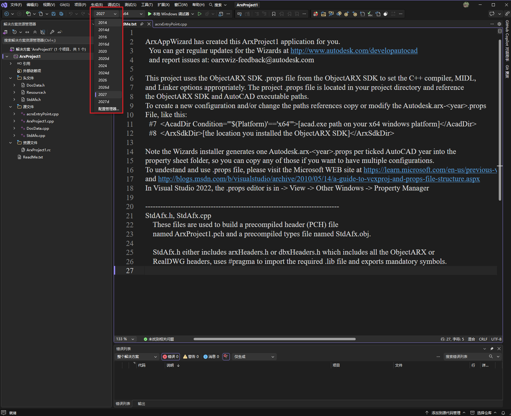

> 建议：第一次使用时保持所有默认选项（ObjectARX + 默认可勾选的年份），先跑通“创建 → 编译 → 加载”全流程，再尝试其他选项。

---

## 7. 向工程中添加 ObjectARX 类

### 7.1 操作方式

在“解决方案资源管理器”中**右键工程 → 添加 → 类**（也可以用“添加 → 新建项”），在弹出的 Visual Studio 向导中找到 **ObjectARXMV** 分类（0.2.8 起为本产品专用分类名，不会与官方 AutoCAD 年份向导的 **ObjectARX** 分类互相覆盖），下面列出 7 个向导（列表中显示的是英文内部名，与中文含义的对照见 [7.3](#73-七个类向导分别做什么)），选择后点击“添加/打开”。

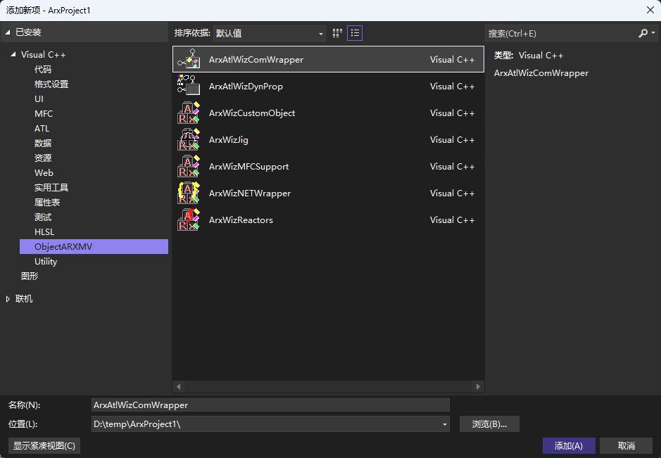

每个类向导同样是英文 HTML 选项界面，按页选择后点击完成即可。例如：

- MFC 类：选择要继承的 AdUi/AcUi 基类（对话框、停靠栏、选项板等），并可选是否向工程插入对话框资源；
- 自定义对象：选择 ObjectDBX 基类与需要实现的协议扩展；
- 反应器：在列表中勾选要继承的反应器基类（30 余种）。

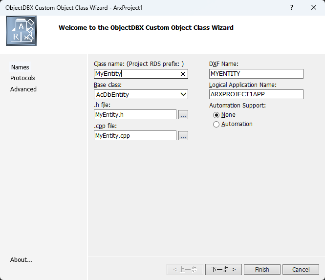

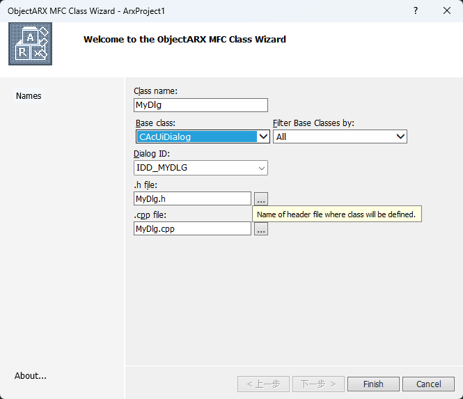

### 7.2 重要提示：请在工程就绪后再添加类

工程刚创建完的半分钟内，Visual Studio 正在后台解析/索引大量头文件。此期间打开“添加新项/添加类”对话框并选中会预填名称的模板，可能触发 VS 自身缺陷导致对话框消失甚至 VS 退出（错误码 `0x80040201`）。

**请等 Visual Studio 状态栏显示“就绪”后再执行添加类操作。** 详见[第 11.4 节](#114-新建工程后立即添加类时-vs-闪退或对话框消失)。

### 7.3 七个类向导分别做什么

| 向导 | 生成的内容 | 典型用途 |
|---|---|---|
| **ObjectDBX Custom Object Class** | 从 ObjectDBX 基类派生的自定义类（自定义实体） | 需要在 DWG 中保存自己的图形对象 |
| **ObjectARX/DBX Transient Reactors Class** | 瞬态反应器类（编辑器、文档、数据库、事件等 30 余种基类可选） | 响应 AutoCAD 的各类事件（图形修改、命令开始、打印等） |
| **ObjectARX Jig Class** | `AcEdJig` 派生类 | 实体绘制过程中的鼠标交互/动态拖拽预览 |
| **ObjectARX MFC Class** | AdUi/AcUi MFC 派生类（对话框、停靠栏、选项板、字段对话框、文件对话框等），可选注入对话框资源 | 做模态/非模态对话框、停靠面板、属性选项板界面 |
| **ObjectARX .NET Wrapper Class** | C++ 类的 C++/CLI 托管包装 | 让 ObjectARX .NET (C#/VB.NET) 代码调用原生 ObjectARX 类 |
| **AutoCAD COM Wrapper Object** | ATL COM coclass 包装 | 向 VBA、.NET COM 互操作等自动化客户端暴露对象 |
| **AutoCAD Object Dynamic Property** | 实现 `IDynamicProperty2` 的 ATL COM 对象 | 在 AutoCAD“特性”选项板中为对象增加自定义动态特性 |

---

## 8. 编译、加载与调试

### 8.1 选择配置并编译

1. 在配置工具栏选择目标年份：**`2024`** 为 Release、**`2024d`** 为 Debug（年份换成您需要的）；
2. 2020 年起平台固定为 **x64**；
3. **生成 → 生成解决方案**（`Ctrl+Shift+B`）。

输出文件位于工程的 `x64\<年份>\`（或 `x64\<年份>d\`）目录，文件名自动带 RDS 前缀和年份，例如 `ADSKMyArxApp2024.arx`。

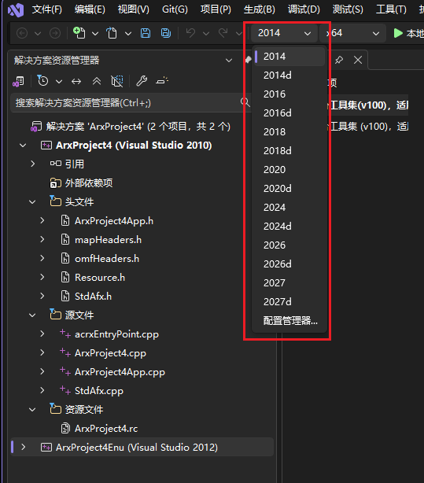


### 8.2 在 AutoCAD 中加载

- `.arx / .dbx / .crx`：在 AutoCAD 中输入命令 **APPLOAD**（或“管理 → 加载应用程序”），选择生成的文件；也可以把文件拖入 AutoCAD 窗口；
- .NET 混合模块（`.dll`）：使用 **NETLOAD** 命令加载；
- 样板工程已带一个测试命令（通常是工程名相关命令），加载后在命令行输入即可验证。


### 8.3 调试设置

右键工程 → 属性 → 调试 → 命令，填写您的 `acad.exe` 完整路径（例如 `C:\Program Files\Autodesk\AutoCAD 2024\acad.exe`），然后按 **F5**：会启动 AutoCAD，APPLOAD 加载生成的模块后，命中断点。

### 8.4 编译报“未找到 ObjectARX <年份> 的属性表”怎么办

报错信息类似：

> 未找到 ObjectARX 2026 的属性表（…Autodesk.arx-2026.props）。请重新运行安装程序勾选该年份，或改用已安装的年份配置。

说明当前选的年份配置在安装时没有勾选。处理方式见[第 10 节](#10-增减目标年份重装与卸载)。

### 8.5 OMF 工程提示缺少 `AecCore.h`

这是本机缺少 **AEC OMF SDK**（建筑垂直产品 SDK）导致的，与向导无关。安装对应版本的 AEC OMF SDK 后再编译；不做垂直产品开发请使用第一个（非 OMF）项目向导。

---

## 9. 年份 / 工具集 / 平台速查表

| AutoCAD 年份 | 平台工具集 | ObjectARX SDK | 可用平台 | .NET 混合模块目标 |
|---|---|---|---|---|
| 2010 | v90 | 18.2 | Win32 / x64 | .NET Framework 3.5 |
| 2012 | v90 | 18.2 | Win32 / x64 | .NET Framework 3.5 |
| 2013 | v100 | 19.1 | Win32 / x64 | .NET Framework 4.0 |
| 2014 | v100 | 19.1 | Win32 / x64 | .NET Framework 4.0 |
| 2015 | v110 | 21.0 | Win32 / x64 | .NET Framework 4.5 |
| 2016 | v110 | 21.0 | Win32 / x64 | .NET Framework 4.5 |
| 2018 | v140 | 22.0 | Win32 / x64 | .NET Framework 4.6 |
| 2019 | v141 | 23.0 | Win32 / x64 | .NET Framework 4.7 |
| 2020 | v141 | 23.1 | **仅 x64** | .NET Framework 4.7 |
| 2021 | v142 | 24.0 | 仅 x64 | .NET Framework 4.8 |
| 2022 | v142 | 24.1 | 仅 x64 | .NET Framework 4.8 |
| 2023 | v142 | 24.2 | 仅 x64 | .NET Framework 4.8 |
| 2024 | v143 | 24.3 | 仅 x64 | .NET Framework 4.8 |
| 2025 | v143 | 25.0 | 仅 x64 | **.NET 8** |
| 2026 | v143 | 25.1 | 仅 x64 | **.NET 8** |
| 2027 | v145 | 26.0 | 仅 x64 | **.NET 10** |

---

## 10. 增减目标年份、重装与卸载

**增减目标年份：**

1. 重新双击 `ObjectARXMultiVersionWizards-classic.exe`，在“目标 AutoCAD 版本”页重新勾选需要的年份组合（会自动回显上次已生成属性表的年份）；
2. 安装器沿用上次的安装目录直接覆盖安装：为新勾年份补生成属性表，并清理已取消年份的属性表；
3. 安装结束后重新启动 Visual Studio。

> 重新运行安装包时不会再询问安装位置，直接沿用上次的目录；需要更换目录请先卸载，或用 `/DIR=<路径>` 静默指定。

也可以用静默方式一次完成，例如只保留 2024/2026/2027：

```bat
ObjectARXMultiVersionWizards-classic.exe /VERYSILENT /SUPPRESSMSGBOXES /YEARS=2024,2026,2027
```

**重新安装（等同修复）：**

本安装器**没有单独的“修复 / 卸载”维护页**：重新双击安装包只是把安装流程再走一遍（跳过“选择安装位置”页），会覆盖已有文件、重新写入向导、重新注册并刷新 VS 向导列表。Visual Studio 更新后向导“消失”，或向导文件被误删时，用它恢复即可。

> ⚠️ 重装会先清掉上一次安装的向导模板文件再重写，所以不要在安装目录里手工改过模板；自建的工程不受影响。

**卸载：**

通过 **设置 → 应用 → 已安装的应用** 卸载 **ObjectARX Multi-Version Wizards**，或到安装目录运行卸载程序（`unins000.exe`）。卸载会移除向导文件、两个版本 Visual Studio 中的向导注册、VS 扩展以及已生成的年份属性表；本版安装器不会向 ObjectARX SDK 目录写入任何文件，也不会影响您的工程文件。

---

## 11. 常见问题

### 11.1 安装程序一启动就提示“本机必须安装 Visual Studio 2022 或 2026”

安装器未在本机检测到受支持的 VS。请确认：

1. 已安装 Visual Studio 2022（17.x）或 2026（18.x），Community/Professional/Enterprise/BuildTools 均可；
2. 如果 VS 装在非标准位置，可在命令行用 `/VSROOT=<VS 安装根目录>` 指定，例如：
   `ObjectARXMultiVersionWizards-classic.exe /VSROOT="<VS 安装根目录>"`（按实际安装位置替换）。

### 11.2 “新建项目”里搜不到 ObjectARX 向导

1. 确认安装时所有 Visual Studio 都已关闭，并在安装完成后重启过 VS（安装后第一次启动 VS 会花一些时间重建向导列表，请耐心等待）；
2. 重新运行安装包重装一遍（覆盖安装并重新注册向导），完成后再次重启 VS；
3. 仍不显示：在 PowerShell 中执行一次 VS 配置刷新（按你的实际 VS 版本与版本号调整路径），完成后再启动 VS：

   ```powershell
   & "${env:ProgramFiles}\Microsoft Visual Studio\2022\Enterprise\Common7\IDE\devenv.exe" /updateconfiguration
   ```

   VS2026 对应路径为 `${env:ProgramFiles}\Microsoft Visual Studio\18\Enterprise\Common7\IDE\devenv.exe`；
4. 也可以删除 VS 的模板缓存目录后重启 VS：`%LOCALAPPDATA%\Microsoft\VisualStudio\<版本实例目录>\VTC`（例如 `18.0_xxxxxxxx`），把该目录改名或删除；
5. 以日志启动 VS 定位：命令行执行 `devenv /log`，复现后查看 `%APPDATA%\Microsoft\VisualStudio\<版本>\ActivityLog.xml`。

### 11.3 安装结束提示“扩展（VSIX）没有装完”

最常见原因是 VS 或 Visual Studio Installer 仍在后台运行。关闭它们后**重新运行安装包重装一遍**即可（已复制的文件不受影响）。

### 11.4 新建工程后立即“添加类”时 VS 闪退或对话框消失

这是 Visual Studio 2022/2026 自身的已知缺陷（工程刚创建时后台正在解析/索引大量头文件，此时在“添加新项/添加类”对话框中选中会预填名称的模板可能触发，错误码 `0x80040201`）。规避方法：

- **等 VS 状态栏显示“就绪”后再添加类**（约半分钟，工程越大越久）；
- 如仍然出现，重新启动一次 VS 后再添加。

### 11.5 版本页里某些年份是灰色、勾不上

灰色表示该年份的属性表尚未在本机生成。重新运行安装包（或静默安装时用 `/YEARS` 指定），在“目标 AutoCAD 版本”页勾上所需年份即可。

### 11.6 安装刚开始就提示“请先关闭 Visual Studio 再安装”

安装器检测到 `devenv.exe`（或 Visual Studio Installer）在运行。请保存工作、关闭所有 VS 窗口后重新运行；此时尚未写入任何内容，直接取消也不会留下残余。

### 11.7 部分年份配置编译失败，提示找不到工具集（如 v90/v100/v140）

旧年份需要旧版平台工具集：打开 Visual Studio Installer → 修改 → 单个组件，勾选对应的 **MSVC vxxx 生成工具**（v140 = VS2015 工具集，v100/v90 等为更早版本）与旧版 Windows SDK。只做 2020 以后版本则无需安装。

### 11.8 编译报“未找到 ObjectARX <年份> 的属性表”

该年份安装时未勾选。按[第 10 节](#10-增减目标年份重装与卸载)重新安装并勾选该年份，或在配置工具栏切换到已安装的年份。

### 11.9 在哪里看安装日志

| 用途 | 位置 |
|---|---|
| 安装/卸载完整日志 | `%TEMP%\ObjectARXWizards-Inno.log` |
| VSIX 扩展安装日志 | `%TEMP%\vsixinstall.log` |

---

*ObjectARX 官方文档：<https://help.autodesk.com/view/OARX/2024/ENU/> · AutoCAD 开发者中心：<https://www.autodesk.com/developer-network/platform-technologies/autocad>*
