做 ObjectARX 二次开发的同学，大概都被两件事折磨过。

**一是新版 Visual Studio 用不了老向导。** 经典的 ObjectARX 向导依赖 `.vsz` 机制，而 VS2026 已经移除了项目级向导入口——装完之后，在「新建项目」里什么都找不到。

**二是一个年份一个工程。** 客户手里的 AutoCAD 从 2014 到 2027 都有，为了多版本兼容，只能复制一堆工程、分别配 SDK 路径、分别改输出名，切一次版本像脱一层皮。

**ObjectARX 多年份向导（Multi-Version Wizards）** 就是冲着这两个痛点来的：

- 一个 VSIX 扩展，同时支持 **Visual Studio 2022（17.x）** 和 **2026（18.x）**；
- **一个工程内置 AutoCAD 2010–2027 全部 16 个年份的编译配置**，在工具栏切换即可，输出文件自动带年份后缀；
- 全程中文图形安装界面，勾选目标年份，一键生成属性表、注册扩展。

下面就用 **dev 单文件安装包**（`ObjectARXMultiVersionWizards-dev.exe`）走完整条链路：安装 → 新建工程 → 添加类 → 编译加载 → 断点调试 → 日后增减年份。

---

## 一、它到底装了什么

安装完成后，Visual Studio 里会多出 **2 个项目模板**和 **7 个类向导**。

**项目模板**（文件 → 新建 → 项目）

- **ObjectARX/DBX/CRX Application (Multi-Version)**：创建 `.arx` / `.dbx` / `.crx` 应用，绝大多数人选择它；
- **ObjectARX/DBX Application with OMF Support (Multi-Version)**：同上，额外支持 OMF/MAP 垂直 SDK（面向 AutoCAD Architecture 等建筑类产品），会多生成一个资源 DLL 子项目。

**七个类向导**（往已有工程里加文件）：自定义实体、瞬态反应器、交互拖拽（Jig）、MFC 界面类、.NET 包装类、COM 包装对象、动态特性——第六节细讲。

那「多年份单工程」到底是什么概念？看一眼生成工程的配置列表就明白了。

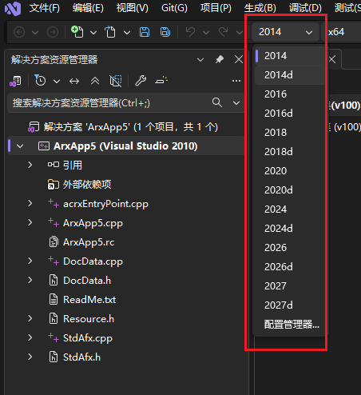

<p style="text-align: center; font-size: 13px; color: #8a94a3; margin: -4px 0 18px; line-height: 1.6;">图 1｜一个工程里的 16 个年份配置</p>

每个年份两套配置：`2024` 是 Release，`2024d` 是 Debug。**切年份就是在下拉框里换一个配置**，再也不用维护十几个工程。

---

## 二、安装前，先备齐这几样

- **系统**：64 位 Windows；
- **Visual Studio**：**2022（17.x）或 2026（18.x）**，Community / Professional / Enterprise 均可。VS Installer 里必须勾选 **「使用 C++ 的桌面开发」** 工作负荷；
- **ObjectARX SDK**：从 Autodesk 开发者网络下载你要支持的各个年份 SDK。只有编译时要用，安装向导本身不强制；
- **AutoCAD**：用来加载、调试生成的模块；
- **旧版生成工具（按需）**：要编译 2010–2019，需在 VS Installer 里加装 **MSVC v141 / v140 / v110 / v100 / v90 生成工具**与对应旧版 Windows SDK；
- **.NET（按需）**：勾选 .NET 混合模块时，2025 / 2026 需要 **.NET 8**，2027 需要 **.NET 10**，更早年份需要对应的 .NET Framework 开发包。

:::warning 安装前请关闭所有 Visual Studio 窗口
连同 Visual Studio Installer 一起关。安装器检测到 VS 正在运行会主动「罢工」——这是在保护扩展注册不写一半，关掉重跑即可。
:::

---

## 三、安装：要点只有一页

双击 `ObjectARXMultiVersionWizards-dev.exe`，UAC 点「是」，只需授权一次。向导全程中文，**真正要你做决定的只有三处**：装到哪、RDS 填什么、勾哪些年份，其余页面一路「下一步」即可。

**1. 装到哪**　默认是 `C:\Program Files\Autodesk\ObjectARX Multi-Version Wizards\`，属性表目录跟着它走，没特殊情况不用改。

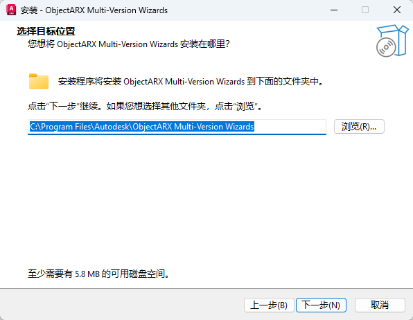

<p style="text-align: center; font-size: 13px; color: #8a94a3; margin: -4px 0 18px; line-height: 1.6;">图 2｜选择安装位置</p>

:::tip 覆盖安装不会再问这一页
安装器直接沿用上次的目录。要换目录请先卸载再装，或用静默参数 `/DIR=` 指定。
:::

**2. RDS 填什么**　最长 4 个字符的开发者前缀，会进生成的代码和输出文件名。**不确定就留空**，自动使用内置的 `ADSK`。

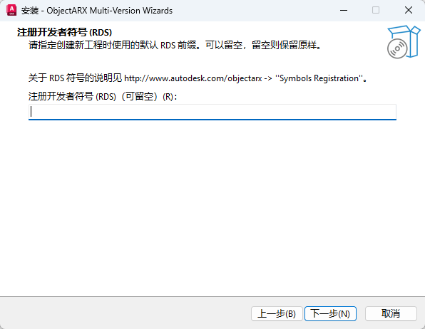

<p style="text-align: center; font-size: 13px; color: #8a94a3; margin: -4px 0 18px; line-height: 1.6;">图 3｜注册开发者符号（RDS）</p>

**3. SDK 与目标位置**　两个路径：Autodesk CAD 根目录、ObjectARX SDK 根目录，默认都是 `C:\Program Files\Autodesk\`。**装在默认位置就整页跳过**——年份由属性表自动拼接，安装器不会往你的 SDK 目录写任何文件。

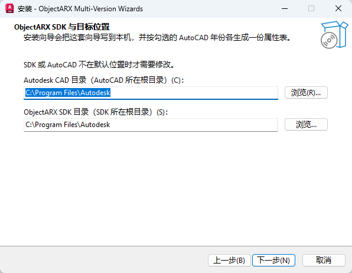

<p style="text-align: center; font-size: 13px; color: #8a94a3; margin: -4px 0 18px; line-height: 1.6;">图 4｜ObjectARX SDK 与目标位置</p>

**4. 勾哪些年份——这一步决定你后面能建什么工程**

- 首次安装默认勾选 **2020、2024、2026、2027**；
- 勾了暂时还没装 SDK 的年份也没有副作用，以后装好 SDK 直接就能编；
- 四个快捷按钮：**全部 / 全不选 / 反选 / 兼容**。其中「兼容」只勾每个二进制兼容代系的代表年份（2014、2016、2018、2020、2024、2026、2027），最省心。

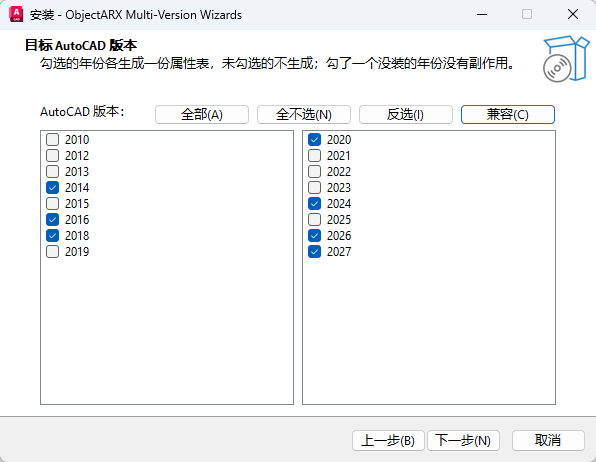

<p style="text-align: center; font-size: 13px; color: #8a94a3; margin: -4px 0 18px; line-height: 1.6;">图 5｜勾选目标 AutoCAD 版本</p>

:::danger 这一页勾错了，后面建工程时补不回来
**勾哪年，就生成哪年的属性表；没生成属性表的年份，新建工程时那个复选框是灰的、根本勾不上。** 所以先把要支持的年份一次性想全——客户还在用 2014，就现在把 2014 勾上。
事后才发现漏了也不要紧：重新双击同一个安装包，在年份页补勾即可，已经建好的工程不用重建。
:::

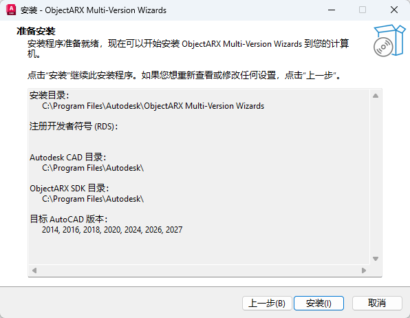

<p style="text-align: center; font-size: 13px; color: #8a94a3; margin: -4px 0 18px; line-height: 1.6;">图 6｜准备安装（设置汇总）</p>

安装过程中会做两件事：① 复制向导文件、生成勾选年份的属性表；② 给本机所有受支持的 VS 实例（2022 和 2026）注册扩展。**每个实例大约 1–2 分钟，耐心等它跑完。**

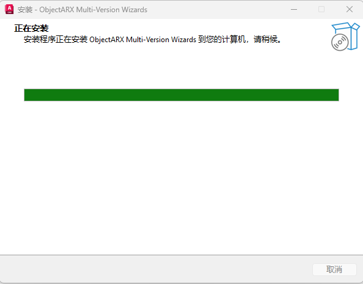

<p style="text-align: center; font-size: 13px; color: #8a94a3; margin: -4px 0 18px; line-height: 1.6;">图 7｜正在安装</p>

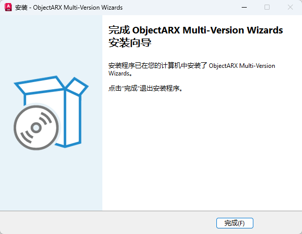

<p style="text-align: center; font-size: 13px; color: #8a94a3; margin: -4px 0 18px; line-height: 1.6;">图 8｜安装完成</p>

看到「安装完成」之后，记得**重新启动 Visual Studio**。

**企业批量部署**可以用静默参数，例如：

```text
ObjectARXMultiVersionWizards-dev.exe /VERYSILENT /SUPPRESSMSGBOXES /YEARS=2020,2024,2026,2027 /RDS=ACME
```

另有 `/DIR=`、`/PROPSDIR=`、`/ACADROOT=`、`/ARXROOT=`、`/VSROOT=`、`/SKIPVSIX=1`、`/SKIPVSCHECK=1` 等参数；年份之间用逗号分隔，不要加空格。

---

## 四、十秒钟验证安装是否成功

打开 Visual Studio：

1. **文件 → 新建 → 项目**（或 `Ctrl+Shift+N`）；
2. 搜索框里输入 **ObjectARX**；
3. 看到那两个 C++ 模板，就说明装好了。

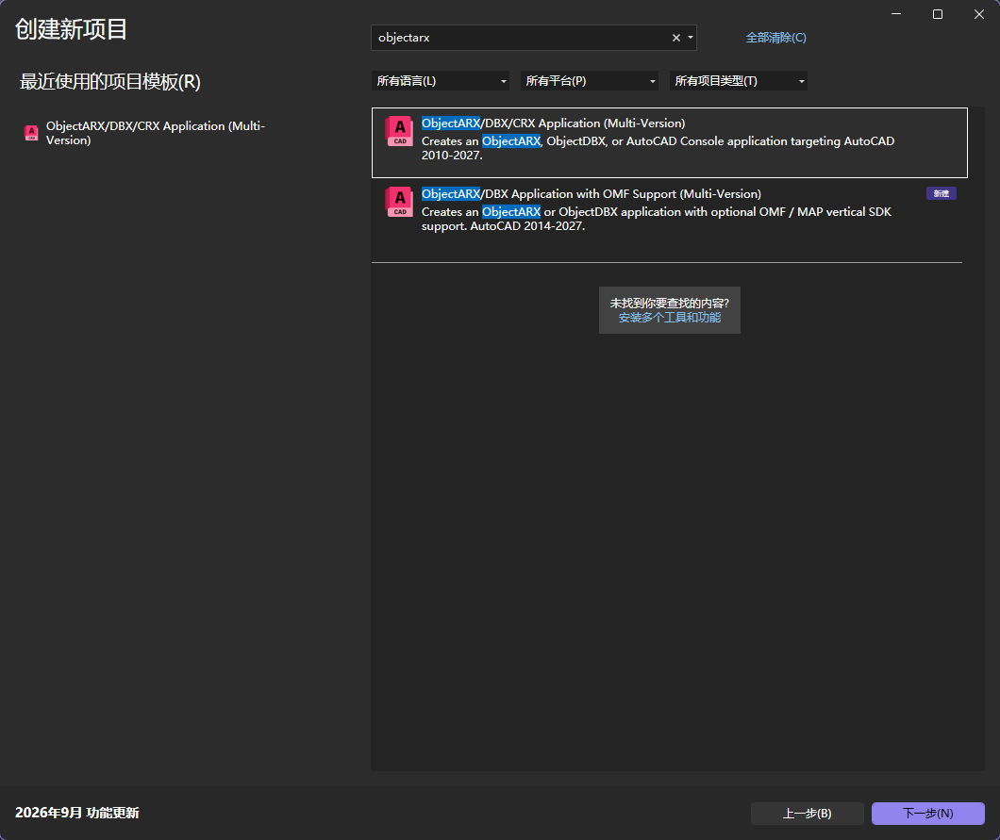

<p style="text-align: center; font-size: 13px; color: #8a94a3; margin: -4px 0 18px; line-height: 1.6;">图 9｜新建项目中搜索 ObjectARX</p>

搜不到？翻到第十节看排查方法，绝大多数情况重装一遍就能解决。

---

## 五、新建第一个工程：选项窗口逐栏看

1. 选择 **ObjectARX/DBX/CRX Application (Multi-Version)**，下一步；
2. 输入工程名（比如 `MyArxApp`）和保存位置，点「创建」；
3. 会弹出一个英文单页选项窗 **ObjectARX/DBX Application Wizard**。

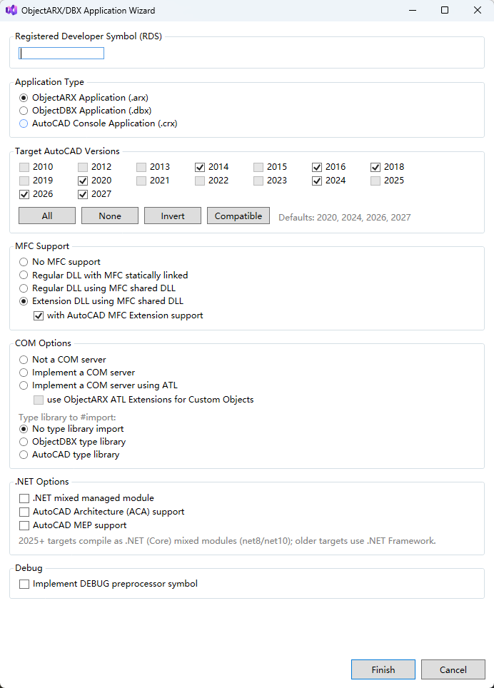

<p style="text-align: center; font-size: 13px; color: #8a94a3; margin: -4px 0 18px; line-height: 1.6;">图 10｜项目向导选项窗口</p>

选项虽然不少，日常只需要关注这几组（**重点是 Target Versions**）：

- **Target Versions**：勾选要纳入工程的年份。列表里每个年份都在，但**只有安装时生成过属性表的那些才能勾选**，其余是灰的，鼠标悬停会提示缺少哪份 props；
- **RDS**：保持默认即可，安装时填的前缀会自动带过来；
- **Application Type**：`.arx` 标准扩展最常用；`.dbx` 是宿主无关的数据库应用；`.crx` 是控制台程序；
- **MFC Support**：纯命令 / 实体开发选 No MFC；要做对话框、停靠面板就选对应 MFC 选项；要用 AutoCAD 的 AdUi / AcUi 界面类则选 Extension DLL；
- **COM Options**：不向 VBA / .NET 暴露 COM 对象就选 Not a COM server，多数人选这个；
- **.NET Options**：需要 C++/CLI 混合模块供 C# 调用时才勾选。2025 起是 .NET 8 / 10，更早年份是 .NET Framework；
- **Debug**：需要预置 `_DEBUG` 宏时再勾。

:::tip 新手建议
第一次全部保持默认（`.arx` + 默认年份），先把「创建 → 编译 → 加载」跑通一遍，回头再研究 MFC、COM、.NET 这些选项。
:::

窗口底部会用红字提示阻止创建的问题，比如一个年份都没选。生成之后你会得到 `acrxEntryPoint.cpp`（命令入口）、`StdAfx`、`DocData` 等一整套样板文件。

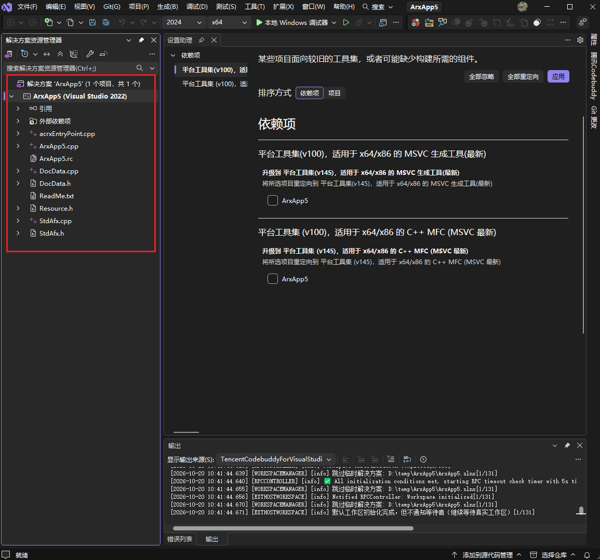

<p style="text-align: center; font-size: 13px; color: #8a94a3; margin: -4px 0 18px; line-height: 1.6;">图 11｜生成后的工程结构</p>

生成的项目统一是 **x64** 配置，每个年份一套 Release、一套 Debug。SDK 属性表里 2010–2020 还保留着 Win32 分支的路径，真要编 32 位得自己在工程里补一个 Win32 平台。

---

## 六、给工程「加类」：请认准这个右键菜单

工程有了，接下来要加自定义实体、反应器、对话框，怎么加？

**推荐方式：在解决方案资源管理器里右键工程节点 → Add ObjectARX Class...**

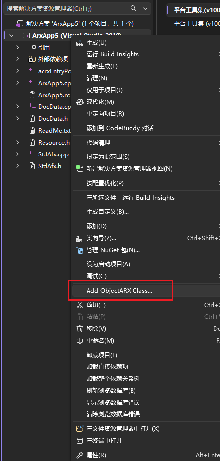

<p style="text-align: center; font-size: 13px; color: #8a94a3; margin: -4px 0 18px; line-height: 1.6;">图 12｜右键菜单入口</p>

在弹出的选择器里挑模板、确认类名即可；部分模板（比如 MFC 类）还会让你再选一次基类。

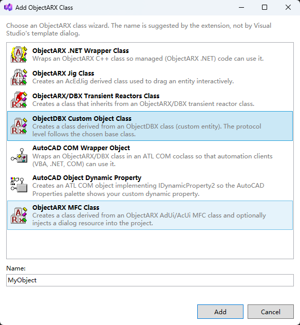

<p style="text-align: center; font-size: 13px; color: #8a94a3; margin: -4px 0 18px; line-height: 1.6;">图 13｜类模板选择器</p>

**为什么专门推荐它？** 因为 VS2022 / 2026 自身有个已知缺陷：工程刚建完的半分钟内，后台正在解析大量头文件，这时走「添加 → 新建项」去选会**预填名称**的模板，可能触发 devenv 闪退，错误码 `0x80040201`。这是 Visual Studio 的锅，不是向导的。而右键菜单这条路完全绕开了有缺陷的对话框，**任何时候点都稳**。

当然，等状态栏显示「**就绪**」之后，用 `Ctrl+Shift+A` 在 **ArxWizard** 分类下选模板也是可以的。

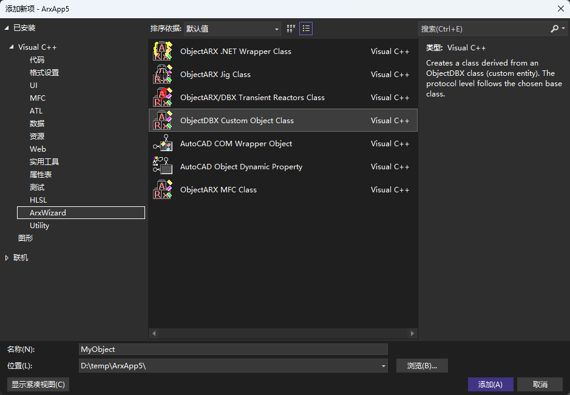

<p style="text-align: center; font-size: 13px; color: #8a94a3; margin: -4px 0 18px; line-height: 1.6;">图 14｜「添加新项」对话框中的 ArxWizard 分类</p>

七个类模板分别能干什么：

- **ObjectDBX Custom Object Class**：自定义实体，把自己的图形对象存进 DWG；
- **ObjectARX/DBX Transient Reactors Class**：30 余种反应器基类，响应图形修改、命令开始、打印等事件；
- **ObjectARX Jig Class**：`AcEdJig` 派生类，绘制时鼠标动态拖拽预览；
- **ObjectARX MFC Class**：AdUi / AcUi 对话框、停靠栏、选项板、文件对话框等 MFC 界面，自动注入对话框资源；
- **ObjectARX .NET Wrapper Class**：C++/CLI 托管包装，让 C# 调用你的原生类；
- **AutoCAD COM Wrapper Object**：ATL COM 对象，给 VBA、COM 互操作客户端用；
- **AutoCAD Object Dynamic Property**：在「特性」选项板里给对象挂自定义动态特性。

---

## 七、编译、在 AutoCAD 里加载、断点调试

**一、选配置，编译。** 配置栏选 `2024`（Release）或 `2024d`（Debug），平台 x64，然后**生成 → 生成解决方案**（`Ctrl+Shift+B`）。

产物落在工程的 `x64\2024\` 或 `x64\2024d\` 目录下，文件名自带 RDS 前缀和年份，例如 `ADSKMyArxApp2024.arx`。Release 与 Debug 同名，靠目录区分。

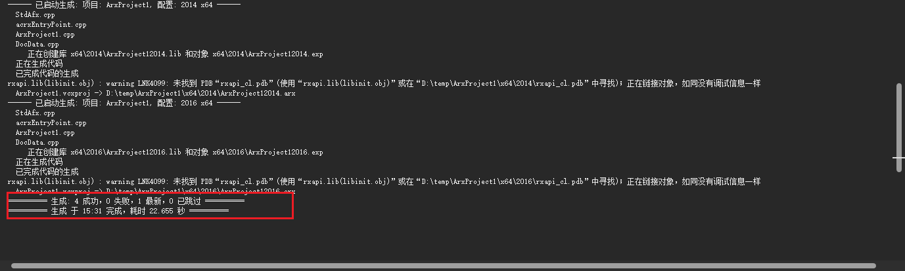

<p style="text-align: center; font-size: 13px; color: #8a94a3; margin: -4px 0 18px; line-height: 1.6;">图 15｜编译成功</p>

**二、加载进 AutoCAD。**

- `.arx / .dbx / .crx`：命令行输入 **APPLOAD**（或「管理 → 加载应用程序」）选文件，**也可以直接把文件拖进 AutoCAD 窗口**；
- .NET 混合模块 `.dll`：用 **NETLOAD** 命令；
- 样板工程自带一个测试命令，加载后在命令行敲命令名就能验证。

**三、F5 断点调试。** 右键工程 → 属性 → 调试 → 命令，填你的 `acad.exe` 完整路径（例如 `C:\Program Files\Autodesk\AutoCAD 2024\acad.exe`）。按 F5 启动 AutoCAD，APPLOAD 加载模块后，断点就能命中。

:::danger 两个高频编译报错，先说解法
报「**未找到 ObjectARX 2026 的属性表（Autodesk.arx-2026.props）**」，说明这个年份安装时没勾。**重跑安装包，在年份页补勾**，不用重装 VS。
OMF 工程报「**找不到 AecCore.h**」，是本机缺 AEC OMF SDK（建筑垂直产品 SDK），与向导无关；不做垂直产品开发就用第一个非 OMF 模板。
:::

---

## 八、年份 / 工具集 / .NET 速查表

建议收藏，选年份、装工具集时对一眼：

| AutoCAD | 平台工具集 | SDK 版本 | .NET 混合模块 |
|---|---|---|---|
| 2010 / 2012 | v90 | 18.2 | .NET Framework 3.5 |
| 2013 / 2014 | v100 | 19.1 | 4.0 |
| 2015 / 2016 | v110 | 21.0 | 4.5 |
| 2018 | v140 | 22.0 | 4.6 |
| 2019 | v141 | 23.0 | 4.7 |
| 2020 | v141 | 23.1 | 4.7 |
| 2021–2023 | v142 | 24.0–24.2 | 4.8 |
| 2024 | v143 | 24.3 | 4.8 |
| 2025 / 2026 | v143 | 25.0 / 25.1 | **.NET 8** |
| 2027 | v145 | 26.0 | **.NET 10** |

只做 2024–2026 的话，装完 VS 就能直接开工；**2020–2023 还得补装 v141 / v142 生成工具**，2019 及更早是 v140 和更老的几套；2027 用的 v145 则要跟着 VS2026 那一代工具链走。

---

## 九、以后想加年份、重装、卸载

**加年份（或减年份）**：重新双击同一个安装包即可。它会沿用上次的安装目录直接覆盖安装，跳过「选择安装位置」页，其余步骤和第一次完全一样。在「目标 AutoCAD 版本」页重新勾选：

- 新勾的年份会补生成属性表；
- 取消勾选的年份会清掉对应属性表，不再生成配置。

:::warning 别在安装目录里手改模板
重装会先清掉上一次装的向导模板文件再重写，所以你在安装目录里手工改的模板会被覆盖。你自己创建的工程完全不受影响。
:::

**重装（等同于修复）**：安装包没有单独的「修复 / 卸载」维护页。VS 大版本更新后模板「消失」、或向导文件被误删，直接重跑安装包就能恢复。

**卸载**：设置 → 应用 → 已安装的应用 → **ObjectARX Multi-Version Wizards** → 卸载；或到安装目录运行 `unins000.exe`。卸载会移除向导文件、VS 扩展、注册表记录和已生成的年份属性表，不会动 ObjectARX SDK，也不会动你的工程。

---

## 十、高频问题排雷

**Q1：新建项目里搜不到 ObjectARX 模板？**

先确认安装时 VS 全部关闭、装完重启过；不行就重跑安装包重装一遍；仍不显示，把模板缓存目录 `%LOCALAPPDATA%\Microsoft\VisualStudio\<版本实例目录>\VTC` 改名后重启 VS；还可以用 `devenv /log` 启动，查 `%APPDATA%\Microsoft\VisualStudio\<版本>\ActivityLog.xml`。

**Q2：刚建完工程，「添加新项」时 VS 闪退或对话框消失？**

VS2022 / 2026 的已知缺陷，错误码 `0x80040201`。**一律右键工程 → Add ObjectARX Class...**，或者等状态栏显示「就绪」之后再添加新项。

**Q3：编译提示找不到 v90 / v100 / v140 工具集？**

旧年份需要旧生成工具：Visual Studio Installer → 修改 → 单个组件，勾上对应的 **MSVC vxxx 生成工具**和旧版 Windows SDK。

**Q4：装到一半提示关闭 Visual Studio？**

说明后台还有 `devenv.exe` 或 Installer 在跑。保存、全部关掉后重试即可。此时没有写入任何文件，取消也不留残余。

**Q5：出问题去哪看日志？**

安装日志在 `%TEMP%\ObjectARXWizards-Inno.log`；向导运行日志在 `%TEMP%\ArxVsixWizard\wizard.log`；VSIX 扩展安装日志在 `%TEMP%\vsixinstall.log`（这是 VSIXInstaller 自己的日志）。

---

## 十一、三条分发线，我该装哪个？

同一套模板、同一份年份表，打包成了三个安装包，功能一致，区别只在「安装体验」：

| 安装包 | 形态 | 适合谁 |
|---|---|---|
| `-dev.exe` | Inno 单文件，中文六页向导，可自选安装目录 | 本文用的就是它，喜欢轻量、直给的安装流程 |
| `-main.exe` | MSI + Burn 引导，五页向导，带「修改安装」维护页 | 企业环境已有 MSI 分发习惯、需要「修复」入口 |
| `-classic.exe` | Inno 单文件，装的是经典 `.vsz` 多页 HTML 向导 | 团队习惯 Autodesk 历年那套经典向导外形 |

三者装出来的 VS 模板是同一套，**装一个就够了，不要混装**。每条的逐页图解、静默参数、故障排查，见仓库 `docs` 目录下的三份使用指南（`-dev` / `-main` / `-classic`）。

## 写在最后

这套向导的价值，说穿了就是把两件最消耗热情的事自动化了：**让新的 Visual Studio 能用上 ObjectARX 工程向导，让一个工程覆盖 AutoCAD 2010–2027 这 16 个年份版本**。装好它之后，你的精力终于可以留在命令逻辑、自定义实体和业务本身。

## 资源获取

安装包、源码和后续更新都在下面两处，两条渠道同步，任选其一即可。

| 渠道 | 获取方式 |
|---|---|
| 官网 | `taorubber.cn` |
| 公众号「橡皮的CAD开发」 | 私信回复 **多版本向导** 或 **ObjectARXMultiVersionWizards** |

关键词备了中英文两版，手机上手打中文、电脑上直接复制英文都行。回复后自动获取下载链接，安装遇到问题也可以直接私信我。

项目基于 Autodesk ADN 的 ObjectARX-Wizards 开源仓库（MIT 协议），想研究实现或自行构建可以看[源码](https://github.com/ADN-DevTech/ObjectARX-Wizards)，官方文档在 [ObjectARX Developer's Guide](https://help.autodesk.com/view/OARX/2024/ENU/)。

如果这篇教程帮你省下了配环境的时间，欢迎**点赞、在看、转发**给身边做 CAD 二次开发的同事——我们下次聊聊怎么用它写第一个自定义实体。
